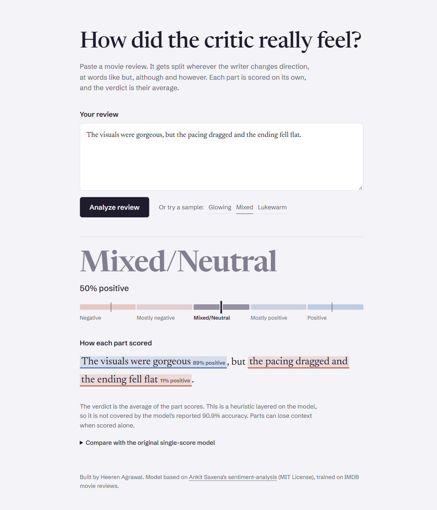
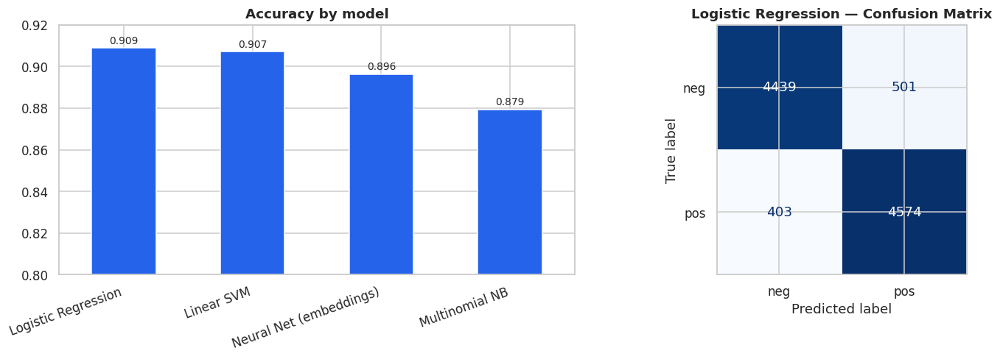
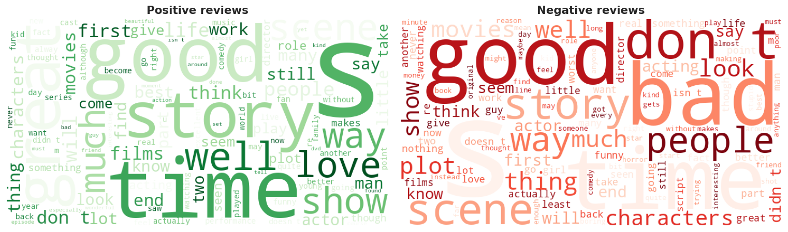
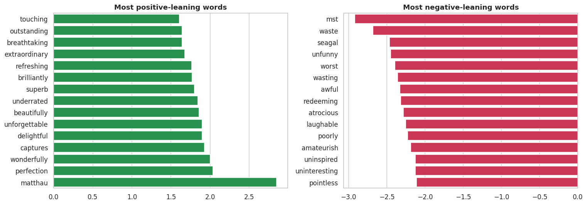
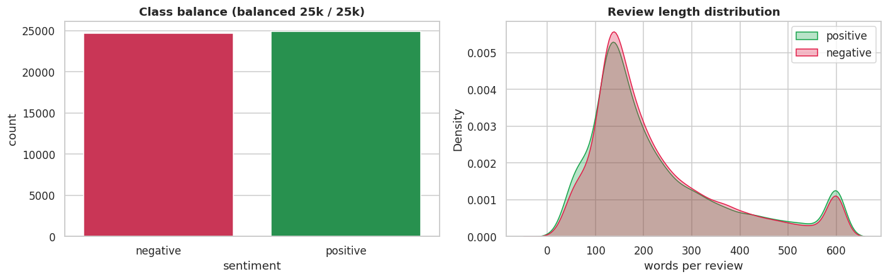

# 🎬 IMDB Sentiment Analysis

**By Heeren Agrawal**

> Read a movie review and decide whether it is **positive** or **negative** — a complete NLP pipeline from raw text to
> prediction, a comparison of classical ML and deep learning, and a **React web app** that shows how each part of a
> review was scored.

<p align="center">
  
  
  
  
  
  
</p>

<p align="center"><b>Best model — TF-IDF + Logistic Regression · 90.9% accuracy · F1 0.910 · ROC-AUC 0.970</b></p>

<p align="center">
  
</p>

---

## 🎯 Overview

**The task:** given the text of a movie review, predict whether its sentiment is positive or negative — the classic
NLP text-classification problem behind review aggregators, brand monitoring and recommendation systems.

**The data:** the IMDB Large Movie Review dataset — **50,000 reviews, perfectly balanced** (25,000 positive /
25,000 negative).

**The result:** after light text cleaning and **TF-IDF** features (single words + word pairs), a **Logistic
Regression** classifier reaches **90.9% accuracy**, beating Naive Bayes, a Linear SVM and an embedding neural
network. A well-tuned linear model is very hard to beat on IMDB.

**The app:** type or paste any review. The app splits it wherever the writer changes direction (*but*, *although*,
*however* …), scores every part, and shows the review back with each part highlighted in its sentiment colour.

## 🛠️ What I improved

This project started from an open-source IMDB sentiment model (see [Acknowledgements](#-acknowledgements)).
I tested it, found where it fell short, and rebuilt the app around it. Every item below is working now.

| Problem in the original | What I changed | Now |
|---|---|---|
| Mixed reviews were hidden behind one label: *"The visuals were gorgeous, but the pacing dragged…"* came out just **Negative (36%)** | Added **clause-level scoring**: split at *but / although / however / though / yet*, score each part, average into 5 bands | Shows **89% + 11% → Mixed/Neutral (50%)** |
| No way to see *why* a review got its score | Built a view that shows the review back with **each part highlighted** in its sentiment colour and score | You can see which phrases pulled the verdict up or down |
| The demo app was tied to a dashboard framework with a fixed look | Replaced it with a **React + Vite frontend** and a small **Python API** (built-in web server, no web framework) | One command runs the whole app; runtime needs only 3 Python packages |
| Fixed, generic UI | Designed a custom interface with a **design-token system** (colours, type, spacing in one file) | Phone-friendly layout, dark mode, colour-blind-safe orange/blue scale, keyboard focus |
| Prediction code lived inside the UI script | Moved the whole prediction pipeline into **`app/pipeline.py`** with a built-in self-check | Testable without the UI: `.venv\Scripts\python app\pipeline.py` |
| Input checking stopped at "is the box empty?" | The API **validates every request** (empty text, invalid JSON, over 5,000 characters) and only listens on this computer | Clear error messages instead of crashes |
| Unclear limits: neutral reviews were confidently mislabelled (*"…okay for a one-time watch"* → **99% Negative**) | Investigated the model's word weights: lukewarm words (*okay*, *average*, *interesting*) carry negative weight because the data has no neutral class | Documented in the Limitations section below, with the next step |
| Two ROC-AUC values were mis-rounded in the results table, and the run guide was outdated | Corrected the figures from `assets/model_comparison.csv`; rewrote `STEPS.md` with setup, run and troubleshooting | Docs match the actual files and numbers |
| The README described the files but not the method | Rewrote it to explain the **pipeline step by step**, where NLP fits in, and a worked example with real outputs | Understandable without reading the code |

## 🧠 How the pipeline works

The project has two pipelines that share the same steps: **training** (in the notebook, run once) and
**prediction** (in the app, run for every review).

```
TRAINING  (Sentiment_Analysis.ipynb)                PREDICTION  (app/pipeline.py, for every review)

50,000 labelled reviews                             "The visuals were gorgeous, but the pacing dragged..."
        │                                                     │
        ▼  1 · Clean                                          ▼  1 · Clean  (same function)
        │                                                     │
        ▼  2 · Fit TF-IDF on 39,665 training reviews          ▼  2 · TF-IDF transform  → 30,000 numbers
        │                                                     │
        ▼  3 · Train Logistic Regression                      ▼  3 · Logistic Regression → P(positive)
        │                                                     │
        ▼  Evaluate on 9,917 held-out reviews                 ▼  4 · Label: ≥ 0.5 Positive, else Negative
        │                                                     │
        ▼  Save to app/  (.joblib files) ───────────────────▶ ▼  5 · Clause-level score → final verdict
```

### 1 · Text cleaning

Raw reviews contain HTML (`<br />`), punctuation, numbers and mixed case. Cleaning makes them uniform:

```python
def clean(t):
    t = TAG.sub(" ", t.lower())   # lowercase, remove HTML tags
    t = NON.sub(" ", t)           # keep letters a-z only
    return WS.sub(" ", t).strip() # collapse extra spaces
```

`"Great film!<br />10/10"` → `"great film"`. Duplicate reviews are dropped (418 removed, leaving 49,582).
The app uses **exactly the same** function, so live text is prepared the same way as the training data.

### 2 · TF-IDF features

A model needs numbers, not words. **TF-IDF** turns each review into 30,000 numbers — one per word or word pair:

- **Unigrams + bigrams** — scores single words (`good`) *and* two-word pairs (`not good`, `waste of`), so some
  negation and phrasing is captured.
- **TF (term frequency)** — a word used more often in the review scores higher (on a log scale, `sublinear_tf`).
- **IDF (inverse document frequency)** — words found in almost every review (`the`, `movie`) are down-weighted;
  rarer, telling words (`masterpiece`, `worst`) are up-weighted.
- Keeps the 30,000 most frequent terms that appear in at least 5 reviews. It is fitted on the training set only,
  so nothing leaks from the test set.

### 3 · Logistic Regression

The classifier learns **one weight per term**: positive words get positive weights, negative words get negative
weights. For a review it adds up *weight × TF-IDF value* for every term, plus a constant, and squashes the total
through a **sigmoid** into a probability between 0 and 1: **P(positive)**.

### 4 · Probability → label

If P(positive) ≥ 0.5 the review is **Positive**, otherwise **Negative**. The confidence shown is P for a positive
label and 1 − P for a negative one.

### 5 · Clause-level score (added in this version)

Mixed reviews pull in both directions, and a single score can hide that. The app therefore:

1. splits the review at sentence ends and at *but / although / however / though / yet*,
2. scores each part with steps 1–4,
3. averages the part scores into a final score, mapped to five bands:
   **0–20% Negative · 20–40% Mostly negative · 40–60% Mixed/Neutral · 60–80% Mostly positive · 80–100% Positive**.

> This is a heuristic layered on the model — it is **not** covered by the reported 90.9% accuracy.

**Worked example** (real outputs):

| Review | Whole review (steps 1–4) | Parts (step 5) | Final verdict |
|---|---|---|---|
| *"An absolute masterpiece. The performances were stunning and the story kept me hooked."* | Positive, 99.0% | 89.4% · 98.9% | **Positive**, 94% |
| *"The visuals were gorgeous, but the pacing dragged and the ending fell flat."* | Negative, 35.9% | 89.2% · 10.5% | **Mixed/Neutral**, 50% |
| *"The movie had some interesting moments, but the storyline was predictable and the acting was just average. It was okay for a one-time watch."* | Negative, 1.0% | 8.9% · 0.8% · 44.6% | **Negative**, 18% |

## 🔤 Where NLP fits in

NLP turns human language into data a model can learn from; machine learning then does the classification.

```
Review text  ──[ NLP: clean, tokenize, represent ]──▶  numbers  ──[ ML: classify ]──▶  Positive / Negative
```

| NLP stage | What it means | Where in this project |
|---|---|---|
| **Task definition** | The language problem being solved | **Sentiment analysis**, a classic NLP text-classification task |
| **Text preprocessing** | Make text uniform | `clean()`: lowercase, strip HTML tags, remove punctuation and numbers, collapse spaces |
| **Tokenization** | Split text into words (tokens) | Inside `TfidfVectorizer`: splits on word boundaries, keeps tokens of 2+ letters |
| **N-grams** | Look at word sequences, not just single words | Unigrams + bigrams (*not good*, *waste of*), which partly captures negation |
| **Text representation** | Turn words into numbers | **TF-IDF** weighting, the core of the NLP side |
| **Vocabulary building** | Decide which words the model knows | 30,000 terms that appear in at least 5 reviews; unknown words are ignored |
| **Word embeddings** | Represent word meaning as vectors | The neural network learns 32-number vectors for 20,000 words |
| **Text EDA** | Study language patterns in the data | Word clouds, stop-word removal for the charts, distinctive words by log-count ratio |
| **Clause segmentation** | Split text into meaningful units | Added in this version: splits at sentence ends and contrast words (*but*, *however*, *although*) |
| **Error analysis** | Find where language understanding fails | Sarcasm, mixed sentiment, negation, lukewarm words like *okay* |

Not used here: stemming/lemmatization, part-of-speech tagging, parsing, and transformer models (BERT and similar),
which read words in context and are the natural next step.

## 🏆 Results

Four models trained on the same stratified 80/20 split (39,665 train / 9,917 test), ranked by accuracy:

| Model | Accuracy | F1 | ROC-AUC |
|---|:--:|:--:|:--:|
| **TF-IDF + Logistic Regression** ⭐ | **0.909** | **0.910** | **0.970** |
| TF-IDF + Linear SVM | 0.907 | 0.908 | 0.969 |
| Neural Net (word embeddings) | 0.896 | 0.897 | 0.959 |
| TF-IDF + Multinomial NB | 0.879 | 0.881 | 0.949 |

<p align="center">
  
</p>

- **Logistic Regression** was deployed: the most accurate, tiny, fast, and it gives probabilities.
- The **neural network** (Embedding → GlobalAveragePooling → Dense) is competitive but does not beat the linear
  models at this scale.
- The figures come from the notebook's evaluation on the held-out test set (`assets/model_comparison.csv` and
  `app/model_meta.json`).

## 📊 Exploratory data analysis

*Great, excellent, wonderful* dominate positive reviews; *worst, waste, awful, boring* dominate negative ones.

<p align="center">
  
</p>
<p align="center">
  
</p>
<p align="center">
  
</p>

The classes are perfectly balanced (so accuracy is a meaningful metric), and review length barely differs by sentiment.

## ⚠️ Limitations

- **No neutral class.** The model was only trained on positive and negative reviews, so it must pick one. Lukewarm
  words like *okay*, *average* and *interesting* lean negative, which is why "okay for a one-time watch" scores Negative.
- **Sarcasm** — "Oh great, another three hours of my life gone" contains *great*; the model counts words, not tone.
- **Word order** — beyond two-word pairs, the model cannot tell how words relate.
- **English only** — cleaning removes every character outside a–z.
- **Domain shift** — trained on movie reviews; tweets, product reviews or slang score less reliably, and words outside
  its 30,000-term vocabulary are ignored.
- **Clause scores lose context** — "I expected to hate it" is scored on its own, without the "but I loved it" that follows.

The error analysis in the notebook shows the model's most confident mistakes are sarcastic and mixed reviews.
A transformer model trained with a neutral class would be the natural next step.

## 🚀 Quick start

```powershell
py -3.12 -m venv .venv
.venv\Scripts\python -m pip install -r requirements.txt
cd frontend; npm install; npm run build; cd ..
.venv\Scripts\python app\api.py        # → open http://127.0.0.1:8000
```

Full step-by-step instructions, live-reload development and troubleshooting: **[`STEPS.md`](STEPS.md)**.
To re-run the analysis notebook, install `requirements-notebook.txt` instead.

## 🗂️ Repository structure

```
sentiment-analysis/
├── Sentiment_Analysis.ipynb     # Training: cleaning → EDA → 4 models → error analysis → saves the model to app/
├── app/
│   ├── pipeline.py              # Prediction pipeline: clean → TF-IDF → Logistic Regression + clause-level score
│   ├── api.py                   # Web server: POST /api/analyze, and serves the built frontend
│   ├── tfidf_vectorizer.joblib  # Fitted TF-IDF vectoriser
│   ├── sentiment_model.joblib   # Trained Logistic Regression
│   └── model_meta.json          # Reported test accuracy, F1, ROC-AUC
├── frontend/                    # React + Vite web app
│   └── src/
│       ├── App.jsx              # Page: review input, verdict, notes
│       ├── components/          # Meter.jsx (5-band scale), MarkedReview.jsx (highlighted parts)
│       ├── tokens.css           # Design tokens: colours, type, spacing
│       └── styles.css
├── data/IMDB-Dataset.csv.gz     # 50k labelled reviews (gzip; pandas reads it directly)
├── assets/                      # Figures (word clouds, model comparison, app screenshot)
├── reports/                     # Written report (DOCX)
├── requirements.txt             # App: scikit-learn, joblib, numpy
├── requirements-notebook.txt    # Notebook: adds pandas, TensorFlow, plotting
└── STEPS.md · LICENSE · README.md
```

## 👤 Author

**Heeren Agrawal** — React frontend, design system, Python API, clause-level scoring, testing and documentation.

## 🙏 Acknowledgements

Trained model and analysis notebook based on [Ankit Saxena's sentiment-analysis](https://github.com/AnkitSaxena-AI/sentiment-analysis)
(MIT License). Released under the [MIT License](LICENSE).

---

<p align="center"><i>Dataset: IMDB Large Movie Review (Maas et al., 2011). For educational use.</i></p>
